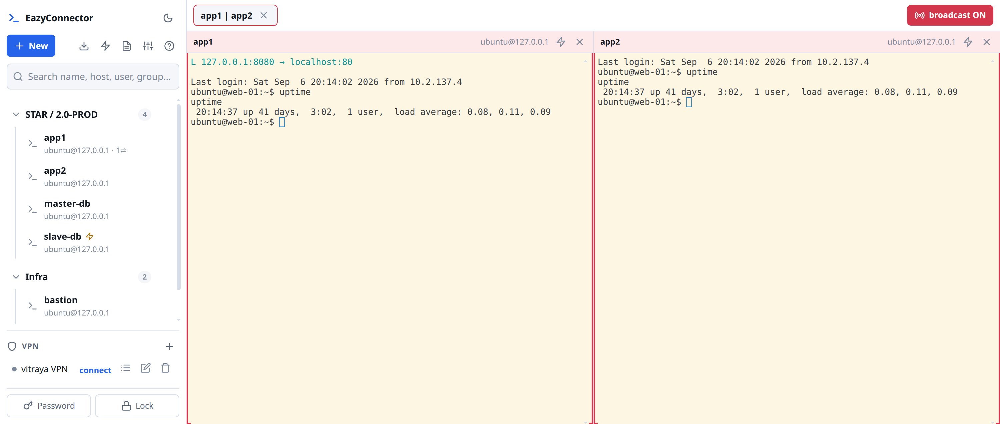

# Shelldeck

[](https://github.com/Gulshan07/Shelldeck/releases)
[](LICENSE)
[](#platform-support)
[](pyproject.toml)
[](https://github.com/Gulshan07/shelldeck/stargazers)

**A connection manager for SSH, SFTP, Telnet and serial consoles, with an
encrypted vault and one-click VPN.**

Shelldeck keeps every server, key and credential you use in one place, opens
them in tabs and split panes, and brings your VPN up with its two-factor code
answered for you. It runs as a small local server and uses your browser as the
interface, so there is nothing to compile and no desktop toolkit to install.

**Available for Linux today. macOS and Windows apps are planned for the next
phase.** If you find Shelldeck useful, please give it a ⭐ star: it helps other
people find it.


*Two servers side by side with broadcast on: one `uptime`, both hosts.*

<details><summary>Light theme</summary>



</details>

## Contents

- [Highlights](#highlights)
- [Quick start](#quick-start)
- [Features](#features)
- [VPN and authenticator codes](#vpn-and-authenticator-codes)
- [Moving from Ásbrú or another machine](#moving-from-ásbrú-or-another-machine)
- [Security model](#security-model)
- [Platform support](#platform-support)
- [Development](#development)
- [Contributing](#contributing)
- [Licence](#licence)

## Highlights

- **Everything in one window.** SSH, Telnet and serial sessions in tabs and
  split panes, with an SFTP browser beside them.
- **Real encryption.** Passwords, private keys, VPN profiles and authenticator
  keys are stored under a master password with scrypt and AES-256-GCM. Nothing
  sensitive is written in plain text.
- **One-click VPN.** OpenVPN is started for you and the password and
  authenticator code are answered automatically.
- **Built for fleets.** Jump hosts chained to any depth, port forwarding,
  broadcast typing to many servers, and macros that run on connect.
- **Local only.** The server listens on `127.0.0.1` and nothing is sent to any
  third party.

## Quick start

### Linux: download and run

Download `Shelldeck-x86_64.AppImage` from the
[latest release](https://github.com/Gulshan07/Shelldeck/releases/latest), then:

```bash
chmod +x Shelldeck-x86_64.AppImage
./Shelldeck-x86_64.AppImage
```

Runs on Ubuntu 22.04 or newer and other distributions of the same age (glibc
2.35+). No Python and no dependencies are needed. If it fails with
`libfuse.so.2: cannot open`, either run `sudo apt install libfuse2` or start it
with `--appimage-extract-and-run`.

### From source

Requires Python 3.10 or newer.

```bash
git clone https://github.com/Gulshan07/Shelldeck.git
cd Shelldeck
python3 -m venv .venv
.venv/bin/pip install -e .
.venv/bin/shelldeck
```

Optional extras:

| Extra | Adds | Install |
|---|---|---|
| `import` | Ásbrú import (PyYAML) | `.venv/bin/pip install -e ".[import]"` |
| `serial` | Serial consoles (pyserial-asyncio) | `.venv/bin/pip install -e ".[serial]"` |

To build your own binary, run `./build.sh`. It produces `dist/Shelldeck` and,
on Linux, an AppImage.

### First run

Shelldeck prints a URL and opens your browser. On first launch you choose a
**master password**. It encrypts the vault and is the only thing that can
decrypt it, so there is no recovery if it is lost. Press <kbd>F1</kbd> at any
time for the built-in manual and the list of keyboard shortcuts.

The VPN feature needs OpenVPN installed (`sudo apt install openvpn`).
Everything else works without it.

## Features

### Sessions

- SSH, Telnet and serial console connections in one tree
- Tabs and split panes with a full terminal ([xterm.js](https://xtermjs.org/))
- Jump hosts (bastions) chained to any depth, with the host key verified at
  every hop
- Port forwarding: local, remote and SOCKS (`L` / `R` / `D`), started and
  stopped with the session
- SFTP browser: navigate, upload, download and search the remote host

### Automation

- **Broadcast:** type once and send it to every terminal in a tab
- **Macros:** `expect` / `send` scripts, attachable per connection, optionally
  run on connect (log in to MySQL, switch to root, and so on)
- **Hooks:** run a command locally before connecting, on the server after
  login, and locally after disconnecting
- **Instances:** open 2 to 7 sessions to the same host side by side

### Records

- Encrypted session logs, enabled per connection
- Playback of a recorded session at its original timing, from 1× to 8×

### Organisation

- Groups with drag-and-drop, collapse and search across name, host, user and
  group
- Clone a connection, credentials included, to add the next server quickly
- Import from `~/.ssh/config` or Ásbrú, with groups and jump hosts preserved
- Export a bundle that contains no secrets, for sharing a setup with a team

### Interface

- 18 themes (Graphite, Midnight, Dracula, Nord, Gruvbox, Tokyo Night,
  Catppuccin, Solarized and more, dark and light), each with a matching terminal palette
- A choice of bundled interface and terminal fonts (JetBrains Mono, Fira Code,
  Cascadia Code, IBM Plex, Inter and others), shipped with the app
- Fully keyboard-navigable, with shortcuts on <kbd>Alt</kbd> so they do not
  collide with the browser's own

## VPN and authenticator codes

Shelldeck drives the system `openvpn` binary through its management interface.
It supports the three ways servers ask for a second factor:
`static-challenge` (SCRV1), a code appended to the password, and a dynamic
`CRV1` challenge. The method is detected from the `.ovpn` file and can be
overridden per profile.

Each VPN profile also states how its authenticator code is supplied:

| Choice | What happens |
|---|---|
| None | The password is sent as is. |
| Ask me each time I connect | Shelldeck asks for the 6-digit code when the server wants it. Nothing is stored. |
| Paste a key or link | Paste the setup key, an `otpauth://` link, or Google Authenticator's export link. The key is stored in the vault and the code is generated for you. |
| Read a QR code image | Choose, drop or paste a screenshot of the QR code. It is decoded in your browser; the image goes nowhere. |

Notes for the two most common authenticator apps:

- **Google Authenticator:** Menu → Transfer accounts → Export accounts, take a
  screenshot of the QR code, and give it to Shelldeck under *Read a QR code
  image*.
- **Microsoft Authenticator:** It never reveals the key. Choose *Ask me each
  time I connect*, or ask your VPN admin to re-issue the QR code and scan it
  into Shelldeck as well as your phone.

After a key is saved, the current code is shown once so it can be compared
with your phone. If the two differ, either the wrong account was chosen or
this computer's clock is off. A wrong clock is also the usual reason a server
rejects a generated code.

## Moving from Ásbrú or another machine

**From Ásbrú.** Install the `import` extra, then choose *Import → Ásbrú*.
Shelldeck reads `~/.config/asbru/asbru.yml` and recreates the groups,
connections and jump hosts. To migrate to a different computer, copy that one
file to the same path there first; Ásbrú itself does not need to be installed.
Saved passwords are deliberately not imported. Key files are read into the
vault, so key-based connections work immediately.

**From `~/.ssh/config`.** Choose *Import → ssh_config*. Hosts, users, ports,
identity files and `ProxyJump` chains are carried over.

**Between Shelldeck installs.** *Export* writes a bundle with the connection
tree and no secrets. Import it on the other machine and re-enter credentials
there.

## Security model

Shelldeck was written for a machine that other people can log in to, so its
defaults assume a hostile local user.

| Area | Guarantee |
|---|---|
| Network | The server binds `127.0.0.1` on an ephemeral port. There is no option to bind elsewhere. |
| Session token | Lives in the URL fragment, which browsers never send to a server, and is never passed as a command argument (`/proc/<pid>/cmdline` is world-readable). |
| Requests | Every request checks `Origin`, and both WebSockets take the token as their first message. This blocks CSRF and DNS rebinding from other browser tabs. |
| Secrets | Never sent to the browser. The page asks to connect; the server authenticates. |
| Vault | scrypt (n=2¹⁷) and AES-256-GCM, locked automatically after 15 minutes idle. |
| Files | `0600` inside a `0700` directory, re-applied on every write. |
| Host keys | Always verified. A new host prompts with its fingerprint; verification is never skipped. |
| Session logs | Encrypted, because a terminal log can contain a password you typed. |
| Exports | Contain no passwords, keys, passphrases, authenticator keys, VPN profiles or macro bodies. |

Everything lives in `~/.shelldeck/`:

```
config.json   0600   hosts, ports, groups: no secrets, safe to sync
vault.enc     0600   AES-256-GCM: passwords, keys, authenticator keys, VPN profiles, macro bodies
known_hosts   0600   pinned SSH host keys
logs/         0700   encrypted session recordings
```

**Reporting a vulnerability.** Please do not open a public issue. See
[SECURITY.md](SECURITY.md) for private reporting, the threat model, and the
design decisions that look like flaws and are deliberate.

## Platform support

Shelldeck is released for Linux. **macOS and Windows apps are planned for the
next phase of development.** Every build must pass
`packaging/smoke.py`, which launches the binary and checks that it serves its
interface, bundles its assets and rejects an unauthenticated request.

| Platform | Status |
|---|---|
| **Linux** | **Released.** Used daily on Ubuntu. AppImage provided. |
| **macOS** | **Next phase.** Code written, not yet released. macOS is POSIX, so the Linux code paths are expected to apply unchanged, but no build has been verified. A binary would be unsigned, so Gatekeeper will warn until it is signed. |
| **Windows** | **Next phase.** Code written, not yet released. The OS-specific paths exist (ACLs through `icacls`, binary-mode vault writes, administrator detection, OpenVPN located in `Program Files`) but have never run on Windows. The VPN will need the app run as Administrator. |

If you run macOS or Windows, testing a build is the most useful contribution
right now. See
[PACKAGING.md](PACKAGING.md) for build instructions and the manual checks.

## Development

```bash
.venv/bin/pip install -e ".[import,serial,test]"   # the test extra is httpx

.venv/bin/python test_p0.py       # vault crypto, file modes, TOTP vectors, parsers
.venv/bin/python test_e2e.py      # full stack against an in-process sshd
.venv/bin/python test_live.py     # real uvicorn, WebSocket, SFTP, import/export
.venv/bin/python test_vpn.py      # the whole OpenVPN conversation (no root needed)
.venv/bin/python test_raw.py      # telnet and serial
.venv/bin/python test_sudokey.py  # reading a root-owned key through sudo
.venv/bin/python test_ui.py       # browser-level checks over Chrome DevTools Protocol
```

The suites are plain scripts with no framework and no fixtures. Run them
directly; piping through `tail` hides the output if one hangs.

| Document | Covers |
|---|---|
| [PLAN.md](PLAN.md) | Architecture and design decisions |
| [PACKAGING.md](PACKAGING.md) | Building binaries and the cross-platform work |
| [CHANGELOG.md](CHANGELOG.md) | What changed in each release |
| [SECURITY.md](SECURITY.md) | Threat model and vulnerability reporting |

## Contributing

Contributions are welcome. Fork the repository, create a branch, run the
suites and open a pull request. `main` accepts reviewed pull requests only;
nobody pushes to it directly. [CONTRIBUTING.md](CONTRIBUTING.md) has the full
workflow and the short list of changes that will be sent back.

## Licence

Released under the [MIT Licence](LICENSE).

## Acknowledgements

- [Ásbrú Connection Manager](https://asbru-cm.net/), the inspiration for this
  project and still the benchmark for this kind of tool.
- [AsyncSSH](https://asyncssh.readthedocs.io/), the SSH implementation doing
  the real work.
- [xterm.js](https://xtermjs.org/) (MIT), vendored in
  `shelldeck/static/vendor/`.
- [jsQR](https://github.com/cozmo/jsQR) (Apache-2.0), vendored alongside it,
  unmodified; reads authenticator QR codes in the browser.
- Fonts bundled in `shelldeck/static/vendor/fonts/` under the SIL Open Font
  License (Inter, IBM Plex Sans and Mono, Source Sans 3, Source Code Pro,
  JetBrains Mono, Fira Code, Cascadia Code) and the Ubuntu Font Licence
  (Ubuntu Mono). Licence texts sit beside the font files.
- Terminal palettes for Dracula, Nord, Gruvbox, Tokyo Night, Catppuccin,
  One Dark, Rosé Pine, Solarized and GitHub follow those projects' published
  (MIT) colour schemes; the interface colours derived from them are adjusted
  where needed to meet contrast minimums.

---

If you like Shelldeck, please give it a ⭐ on GitHub. It helps other people
find it, and it tells me the macOS and Windows apps are worth building next.
