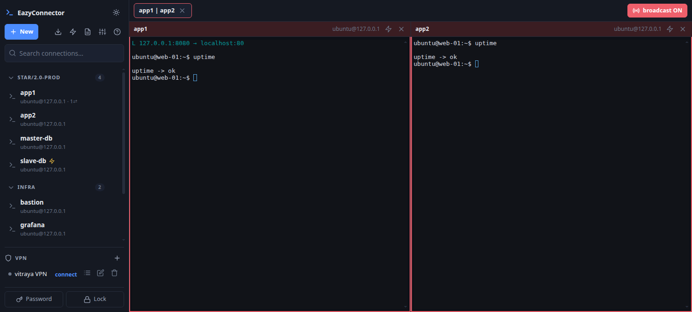

# EazyConnector

A connection manager for people who live in terminals — SSH, SFTP, Telnet and
serial consoles, an encrypted local vault, and one-click VPN with automatic
two-factor. It runs as a small local server and uses your browser as the UI, so
the same build works on any machine that runs Python.



*Two servers open side by side with **broadcast** on — one `uptime`, both hosts.*

---

## Why it exists

[Ásbrú Connection Manager](https://asbru-cm.net/) is excellent, and this project
is openly modelled on it. Three things pushed me to build something else:

- **It's effectively Linux-only.** Perl + GTK is hard to move to macOS or a
  colleague's Windows laptop. EazyConnector is one Python codebase with a
  browser UI, and ships as a single self-contained binary.
- **Saved passwords weren't really encrypted.** Ásbrú's default is a *hardcoded*
  cipher key, so anyone who can read `asbru.yml` can recover every stored
  password. EazyConnector encrypts everything under a master password only you
  know — scrypt + AES-256-GCM — and nothing sensitive is ever written in plain
  text.
- **Nothing did the VPN dance for me.** Connecting meant typing a password plus
  a 6-digit code, every time. Here it's one click: the code is generated and
  answered over OpenVPN's management interface.

It was built for a shared, multi-user Linux box, which shaped the whole security
model below.

## Features

**Sessions**
- SSH, **Telnet** and **serial console** connections in one place
- Tabs and split panes, with a real terminal (xterm.js)
- **Jump hosts / bastions**, chained to any depth, host key verified at every hop
- **Port forwarding** — local, remote and SOCKS (`L` / `R` / `D`), started and
  torn down with the session
- **SFTP browser** — navigate, upload, download, and search the remote host

**Automation**
- **Clusters** — broadcast your typing to every terminal in a tab; run one
  command across a fleet
- **Macros** — `expect` / `send` scripts, attachable per connection and able to
  run automatically on connect (log straight into MySQL, `sudo` to root…)
- Run a command locally before connecting, on the server after login, and
  locally after disconnecting

**Records**
- **Encrypted session logs**, opt-in per connection
- **Recording playback** — replay a session at its original timing, 1×–8×

**Networking**
- **One-click OpenVPN** with password + TOTP answered for you; supports all
  three second-factor dialects (`static-challenge`/SCRV1, appended, and dynamic
  `CRV1` challenge)

**Getting your servers in and out**
- **Import** from `~/.ssh/config` or Ásbrú — grouped, with jump hosts linked
- **Export** a secret-free bundle to share your setup with teammates
- Groups with drag-to-organise, collapse, and search

**The UI**
- Light and dark, fully keyboard-navigable, with a built-in manual (<kbd>F1</kbd>)

## Install

### Linux — download and run

Grab `EazyConnector-x86_64.AppImage` from the
[releases](../../releases), then:

```bash
chmod +x EazyConnector-x86_64.AppImage
./EazyConnector-x86_64.AppImage
```

No Python, no dependencies. If it fails with `libfuse.so.2: cannot open`,
either `sudo apt install libfuse2` or run it with
`--appimage-extract-and-run`.

### From source

Requires Python 3.10+.

```bash
git clone https://github.com/Gulshan07/EazyConnector.git
cd EazyConnector
python3 -m venv .venv
.venv/bin/pip install -e .
.venv/bin/eazyconnector
```

Optional extras: `.venv/bin/pip install -e ".[import]"` for Ásbrú import
(PyYAML), `".[serial]"` for serial consoles (pyserial-asyncio).

### Build your own binary

```bash
./build.sh          # -> dist/EazyConnector and, on Linux, an .AppImage
```

### Running it

It prints a URL and opens your browser. On first launch you choose a **master
password** — it encrypts everything, and it is the only thing that can decrypt
your vault. Press <kbd>F1</kbd> for the full manual.

For the VPN feature you also need OpenVPN installed
(`sudo apt install openvpn`); everything else works without it.

## Security model

This was written for a machine other people can log into, so the defaults
assume a hostile local neighbour:

- **The server binds `127.0.0.1` on an ephemeral port.** There is no flag to
  bind it anywhere else.
- **The session token lives in the URL fragment**, which browsers never send to
  the server, so it stays out of request logs. It is never passed as a command
  argument either — `/proc/<pid>/cmdline` is world-readable.
- **Every request checks `Origin`**, and both WebSockets take the token as their
  first message, which blocks CSRF and DNS rebinding from other browser tabs.
- **Secrets never reach the browser.** The page asks to connect; the server
  performs the authentication.
- **The vault** is scrypt (n=2¹⁷) + AES-256-GCM, auto-locking after 15 minutes
  idle. Hostnames and ports live in a separate plain config with no secrets, so
  it stays diffable.
- **Files are `0600` inside a `0700` directory**, re-applied on every write.
- **Host keys are verified**, always. A new host prompts with its fingerprint;
  verification is never silently skipped.
- **Session logs are encrypted**, because a terminal log can contain a password
  you typed.
- **Exports contain no secrets** — no passwords, keys, passphrases, TOTP
  secrets, VPN profiles or macro bodies.

Everything lives in `~/.eazyconnector/`:

```
config.json   0600   hosts, ports, groups — no secrets, safe to sync
vault.enc     0600   AES-256-GCM: passwords, keys, TOTP secrets, macro bodies
known_hosts   0600   pinned SSH host keys
logs/         0700   encrypted session recordings
```

## Platform support

There is a three-OS build workflow, run on demand from the Actions tab, in
which each binary must pass `packaging/smoke.py` — it launches the binary and
checks it serves, bundles its assets and enforces its auth token.

| | Status |
|---|---|
| **Linux** | Supported and used daily. AppImage provided. |
| **Windows** | The OS-specific paths are implemented — ACL-based file locking via `icacls`, admin detection, and OpenVPN found in `Program Files` — but no Windows binary has been through the smoke test yet, so treat it as untested and please report what breaks. Build it yourself with `pyinstaller --clean -y eazyconnector.spec`. The VPN needs the app run **as Administrator** (Windows has no `sudo` to pipe a password to) and the app says so rather than failing obscurely. |
| **macOS** | Untested. It is POSIX, so the Linux paths should apply unchanged. Unsigned, so Gatekeeper will warn until someone signs it. |

Contributions for macOS/Windows are very welcome — see
[PACKAGING.md](PACKAGING.md).

## Development

```bash
.venv/bin/pip install -e ".[import,serial,test]"   # test extra = httpx, for the suites

.venv/bin/python test_p0.py       # vault crypto, file modes, TOTP vectors, parsers
.venv/bin/python test_e2e.py      # full stack against an in-process sshd
.venv/bin/python test_live.py     # real uvicorn + WebSocket + SFTP + import/export
.venv/bin/python test_vpn.py      # the whole OpenVPN conversation (no root needed)
.venv/bin/python test_raw.py      # telnet + serial
.venv/bin/python test_sudokey.py  # reading a root-owned key via sudo
.venv/bin/python test_ui.py       # browser-level checks over Chrome DevTools Protocol
```

They are plain scripts — no framework, no fixtures. Run them directly rather
than piping through `tail`, which hides output if one hangs.

Architecture and design decisions are in [PLAN.md](PLAN.md); packaging and the
cross-platform story in [PACKAGING.md](PACKAGING.md).

## Licence

[MIT](LICENSE) — use it, fork it, ship it.

## Acknowledgements

- [Ásbrú Connection Manager](https://asbru-cm.net/) — the inspiration, and still
  the benchmark for this kind of tool.
- [xterm.js](https://xtermjs.org/) (MIT) — vendored in
  `eazyconnector/static/vendor/`.
- [AsyncSSH](https://asyncssh.readthedocs.io/) — the SSH implementation doing
  the real work.

---

MIT · PRs and issues welcome · ⭐ it if it saved you a weekend
